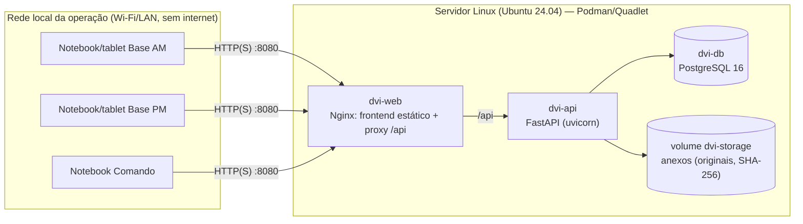
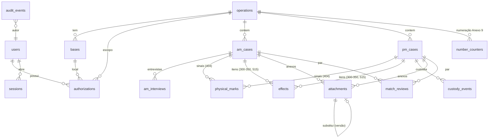

# Arquitetura

## Diagrama lógico (uma instalação)



Somente `dvi-web` publica porta na rede. API e banco ficam em uma rede interna do Podman.

## Fluxo de autorização

```mermaid
sequenceDiagram
  participant U as Navegador
  participant A as API
  participant D as PostgreSQL
  U->>A: POST /api/auth/login (usuário, senha)
  A->>D: verifica hash Argon2id; cria sessão (hash do token)
  A-->>U: cookie HttpOnly SameSite=Strict
  U->>A: PUT /api/auth/context (operação, base, função)
  A->>D: existe Authorization ativa (usuário+operação+base+função)?
  alt autorizado
    A->>D: grava contexto na sessão + evento de auditoria
  else não autorizado
    A->>D: auditoria NEGADO
    A-->>U: 403
  end
  U->>A: qualquer endpoint
  A->>D: revalida sessão e autorização; aplica permissão da função; filtra pela operação
```

## Modelo entidade-relacionamento



| Entidade do prompt | Tabela |
|---|---|
| Usuário / Autorização | `users`, `authorizations` |
| Operação / Base / Contexto | `operations`, `bases`, `sessions` (contexto ativo) |
| Caso AM / Entrevista | `am_cases`, `am_interviews` |
| Registro PM / Evidência | `pm_cases`, `effects` (pertences), `custody_events`, `attachments.evidence_ref` |
| Anexo | `attachments` |
| Evento de Auditoria | `audit_events` (gatilho bloqueia UPDATE, DELETE e TRUNCATE) |
| Comparação | `match_reviews`, que guarda um *snapshot* do resultado, a versão do algoritmo e os parâmetros |

## Motor de comparação (v0.1.0)

Código: `backend/app/services/matching.py`.

| Atributo | Regra | Desfechos |
|---|---|---|
| Sexo (cabeçalho AM × 535 PM) | Valor desconhecido ou indeterminado resulta em "sem dados". Valores diferentes geram divergência **crítica**. | coincidente, divergente ou sem dados |
| Idade (data de nascimento + data do desastre, ou idade informada × faixa 540) | Dentro da faixa: compatível. Fora da faixa, mas dentro de ±5 anos: inconclusivo. Além disso: divergente. | compatível, inconclusivo, divergente ou sem dados |
| Estatura (408 × 408) | A distância entre as faixas é comparada com a tolerância (5 cm). | compatível, inconclusivo, divergente ou sem dados |
| Sinais (404) | Mesmo tipo e mesma região: coincidente. Mesma região do lado oposto: divergência crítica de lateralidade. Sinal relatado no AM e registrado como "NEGATIVO" no PM: divergente. Situação "não informado", "não observado" ou "não examinável": sem dados. Sinal só no PM: informativo. | |
| Tatuagens | Vocabulário controlado de motivos (ex.: rosa → FLORAL), mais semelhança textual RapidFuzz apresentada como **auxiliar**. | |
| Itens (300–350) | Mesmo tipo de item, comparando cor e texto. Pertences são evidência secundária. | compatível ou inconclusivo |
| Implantes (515) | Número de série idêntico após normalização: coincidente. Número diferente: divergência crítica. | |

**Ordenação:** primeiro os pares sem divergência crítica, depois pelo índice técnico (soma de pesos configuráveis).
O índice é rotulado como experimental e **não é probabilidade**. Não existe status de "identificado": os status de
revisão são SUGERIDO, EM_ANALISE, INFORMACOES_COMPLEMENTARES, DESCARTADO e ENCAMINHADO_AVALIACAO_TECNICA.

## Segurança implementada

- Senhas com Argon2id, sessão com token aleatório de 256 bits (no banco fica só o SHA-256 do token) e expiração configurável.
- CSRF: cookie SameSite=Strict e cabeçalho obrigatório `X-DVI-Request` em todas as escritas.
- Limitação de tentativas de login (5 a cada 15 minutos por usuário e IP, na memória do processo).
- Isolamento por operação em todas as consultas, com retorno 404 para registros de outra operação.
- Anexos: validação pelos bytes (assinatura, decodificação com Pillow e leitura com pypdf), recusa de extensão
  incoerente, PDF cifrado e tipos não permitidos, limite de tamanho, armazenamento fora do webroot com permissão 0440,
  verificação de hash após gravar e EXIF/GPS removidos na visualização. O original é preservado.
- Cabeçalhos `Cache-Control: no-store`, `X-Content-Type-Options` e CSP nas respostas de arquivo. CSP restritiva no Nginx.

## Evolução para três bases (proposta, **não implementada**)

1. Uma instalação por base, cada uma com seu banco. Os UUIDs e `origin_base_id` já existem.
2. Pacotes de exportação assinados e cifrados (manifesto, versão do esquema, hashes dos anexos) transportados por mídia
   removível autorizada ou pelo enlace IP com VPN.
3. Importação idempotente pelo UUID. Conflitos de versão vão para uma fila de revisão humana, sem replicação
   multi-writer de PostgreSQL.
4. Integração com o SPT Web somente após contrato de API aprovado.
